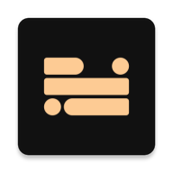
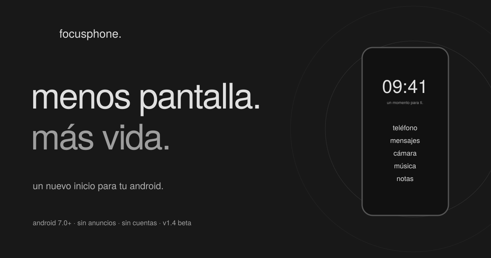

<div align="center">



# FOCUSPHONE · WEB

<strong>la landing oficial de <a href="https://focusphone.rezzt.dev">focusphone</a>, el launcher minimalista para android:<br>
una pantalla de inicio de solo texto, perfiles de concentración y una pausa para volver a elegir.</strong>

<br><br>



<br><br>


<br>


<a href="./license.md"></a>

<br><br>

<a href="https://focusphone.rezzt.dev"><b>sitio web</b></a> ·
<a href="#desarrollo-local"><b>desarrollo</b></a> ·
<a href="./.docs/project-docs/design-doc.md"><b>diseño</b></a> ·
<a href="./.docs/project-docs/motion-doc.md"><b>movimiento</b></a> ·
<a href="./security.md"><b>seguridad</b></a> ·
<a href="https://github.com/rezzt-dev/focusphone-app"><b>la aplicación</b></a>

</div>

---

## ÍNDICE

- [qué es](#qué-es)
- [qué encontrarás en la web](#qué-encontrarás-en-la-web)
- [principios](#principios)
- [stack tecnológico](#stack-tecnológico)
- [estructura del repositorio](#estructura-del-repositorio)
- [desarrollo local](#desarrollo-local)
- [calidad y verificación](#calidad-y-verificación)
- [seo y publicación](#seo-y-publicación)
- [privacidad y medición](#privacidad-y-medición)
- [disponibilidad pública](#disponibilidad-pública)
- [documentación del proyecto](#documentación-del-proyecto)
- [contribuir](#contribuir)
- [licencia](#licencia)
- [autor](#autor)

---

## QUÉ ES

este repositorio contiene **la landing informativa en español de focusphone**. es un proyecto
estático e independiente de la [aplicación android](https://github.com/rezzt-dev/focusphone-app):
sin backend, sin cuentas y sin servicios de analítica.

la web hace tres cosas:

1. **explica el problema**: los launchers están diseñados para que abras aplicaciones; focusphone
   está diseñado para que pases por la pantalla de inicio, no para que te quedes en ella.
2. **deja probar el producto antes de instalarlo**: un teléfono html/css interactivo con temas,
   relojes y perfiles, y una pausa de respiración consciente.
3. **es honesta con el estado del proyecto**: la app está en beta `1.4`, no se anuncia en
   google play y no hay descargas ni enlaces que no existan.

> los teléfonos de la web son **representaciones ilustrativas** en html/css, no capturas oficiales.
> sus botones muestran mensajes de ejemplo; no abren aplicaciones.

---

## QUÉ ENCONTRARÁS EN LA WEB

<table>
<tr>
<th align="left" width="28%">ruta</th>
<th align="left">contenido</th>
</tr>
<tr>
<td valign="top"><code>/</code></td>
<td valign="top">

portada con filosofía, experiencia del launcher (temas y reloj), perfiles `normal`, `trabajo` y `detox`,
pausa consciente, privacidad, proyecto, primeros pasos, preguntas frecuentes, formulario de consulta
y llamada a la acción final.

</td>
</tr>
<tr>
<td valign="top"><code>/instalar/</code></td>
<td valign="top">guía de instalación del APK, configuración inicial y cómo volver al launcher anterior.</td>
</tr>
<tr>
<td valign="top"><code>/privacidad/</code></td>
<td valign="top">qué guarda la app, para qué sirven sus permisos opcionales y qué hace (y no hace) esta web.</td>
</tr>
<tr>
<td valign="top"><code>/proyecto/</code></td>
<td valign="top">estado del proyecto mientras el repositorio de la app no sea público.</td>
</tr>
<tr>
<td valign="top"><code>/404.html</code> · <code>/robots.txt</code></td>
<td valign="top">página de error real y robots con referencia al sitemap.</td>
</tr>
</table>

los destinos de campaña recomendados son `/#experiencia`, `/#perfiles` y `/#descargar`, según la intención.

---

## PRINCIPIOS

| principio | cómo se aplica en el código |
|---|---|
| **la web es el producto** | el diseño parte de la propia app: paleta slate y off-white, tipografía poppins, voz en minúsculas |
| **html primero** | todo el contenido es legible sin javascript; el js solo mejora demos, navegación y movimiento |
| **sin prueba social inventada** | no hay testimonios, valoraciones, contadores de descargas ni cuentas atrás |
| **movimiento con propósito** | un sistema declarativo con tokens (`motion.css`) y soporte completo de `prefers-reduced-motion`; sin bucles perpetuos ni secuestro del scroll |
| **accesible por construcción** | foco visible, jerarquía semántica, enlace de salto, pestañas con teclado, `details` nativo y contraste AA |
| **privacidad local** | cero cookies, cero píxeles, cero peticiones de medición; ni siquiera se cargan fuentes externas |
| **presupuestos que fallan el build** | `npm run test:budgets` limita el js a 40 KiB y el css a 15 KiB gzip entre todas las páginas |

---

## STACK TECNOLÓGICO

<table>
<tr>
<td align="center" width="140"><a href="https://astro.build"></a><br><sub><b>astro 7</b><br>generación estática</sub></td>
<td align="center" width="140"><a href="https://tailwindcss.com"></a><br><sub><b>tailwind 4</b><br>tokens y utilidades</sub></td>
<td align="center" width="140"><a href="https://www.typescriptlang.org"></a><br><sub><b>typescript 6</b><br>scripts tipados</sub></td>
<td align="center" width="140"><a href="https://animejs.com"></a><br><sub><b>anime.js 4</b><br>movimiento y respiración</sub></td>
<td align="center" width="140"><a href="https://lucide.dev"></a><br><sub><b>lucide</b><br>iconos tree-shaken</sub></td>
</tr>
<tr>
<td align="center" width="140"><a href="https://playwright.dev"></a><br><sub><b>playwright</b><br>e2e en 3 motores</sub></td>
<td align="center" width="140"><a href="https://github.com/dequelabs/axe-core"></a><br><sub><b>axe-core</b><br>accesibilidad</sub></td>
<td align="center" width="140"><a href="https://prettier.io"></a><br><sub><b>prettier</b><br>formato</sub></td>
<td align="center" width="140"><a href="https://fontsource.org"></a><br><sub><b>fontsource</b><br>poppins + jetbrains mono</sub></td>
<td align="center" width="140"><a href="https://nginx.org"></a><br><sub><b>nginx</b><br>configuración de ejemplo</sub></td>
</tr>
</table>

las fuentes son las mismas familias que incluye la aplicación (poppins y jetbrains mono) y se sirven
autoalojadas en woff2 latino.

---

## ESTRUCTURA DEL REPOSITORIO

```text
focusphone-web/
├── readme.md · security.md · license.md · agents.md · claude.md
├── .docs/                        # documentación interna (ignorada por git)
│   ├── project-docs/             # product, design, motion y audit
│   ├── commit-guidelines.md
│   └── pr-merge-release-guidelines.md
└── web/                          # el proyecto astro
    ├── src/
    │   ├── pages/                # landing, instalar, privacidad, proyecto, 404, robots.txt
    │   ├── components/           # Header, Footer, Icon (lucide), Phone, MotionBoot
    │   ├── layouts/Base.astro    # metadatos, fuentes y estilos globales
    │   ├── data/site.ts          # versión, enlaces y preguntas frecuentes
    │   ├── scripts/              # demos, navegación, respiración y sistema de animación
    │   └── styles/               # global.css (tailwind y tokens) y motion.css
    ├── public/                   # imágenes, licencias, _headers y descargas
    ├── scripts/                  # build de producción y verificadores (seo, enlaces, presupuestos)
    ├── tests/                    # playwright + axe-core
    └── deploy/nginx.conf         # política de caché, gzip y 404 real para nginx
```

| fichero | para qué sirve |
|---|---|
| `web/src/data/site.ts` | **fuente única** de versión, enlaces públicos y preguntas frecuentes |
| `web/src/styles/motion.css` | tokens de movimiento, estados iniciales y transiciones de página |
| `web/src/scripts/animations/` | sistema declarativo (`reveal`, `scroll`, `header`, `pointer`, `tokens`, `utils`) basado en atributos `data-*` |
| `web/scripts/build-production.mjs` | valida configuración, compila y ejecuta las comprobaciones de seo, presupuestos y destinos públicos |

---

## DESARROLLO LOCAL

requiere **node.js 22.23.4 o posterior** y npm.

```bash
cd web
npm ci
npm run dev
```

abre la url que imprima astro (normalmente <http://localhost:4321>).

| comando | qué hace |
|---|---|
| `npm run dev` | servidor de desarrollo |
| `npm run check` | tipos de astro y typescript |
| `npm run build` | comprobación y generación estática en `dist/` |
| `npm run preview` | sirve la compilación local |
| `npm run format` / `format:check` | formatea / comprueba el formato |
| `npm run install:browsers` | instala chromium, firefox y webkit para playwright |
| `npm run test:e2e` | pruebas de interacción, móvil y accesibilidad |
| `npm run build:production` | compilación de producción con todas las verificaciones |
| `npm run prepare:assets` | regenera la tarjeta social tras cambiar marca o versión |

> `.npmrc` desactiva los enlaces de ejecutables y los scripts llaman a node directamente. así el
> proyecto funciona también en exfat y en linux, macos y windows con sistemas de ficheros
> convencionales.

---

## CALIDAD Y VERIFICACIÓN

las pruebas de playwright comprueban, en escritorio y móvil:

- temas, relojes e interacción del teléfono ilustrativo.
- pestañas de perfiles con teclado, respiración con cancelación y menús móvil y de tableta.
- validación del formulario y preparación del borrador sin publicar nada.
- preguntas frecuentes, páginas y enlaces internos, y ausencia de desbordamiento horizontal.
- accesibilidad automática con axe-core.

```bash
npm run build:production   # configuración, compilación, seo, presupuestos y destinos públicos
npm run test:e2e           # chromium, firefox y webkit
```

> la comprobación automática complementa la revisión visual; **no constituye una certificación de
> accesibilidad**. los presupuestos y las pruebas locales tampoco sustituyen la medición en campo.

navegadores soportados: chrome 111+, safari 16.4+ y firefox 128+. android 7.0 es el requisito de
la *app*, no del navegador.

---

## SEO Y PUBLICACIÓN

el origen canónico por defecto es `https://focusphone.rezzt.dev`. para publicar con otro origen https:

```bash
PUBLIC_SITE_URL=https://tu-dominio.tld npm run build:production
```

también puedes copiar `web/.env.example` a `web/.env`. `build:production` rechaza http, credenciales,
rutas, parámetros y fragmentos en el origen, y genera siempre canonical, open graph absoluto, sitemap
y su referencia en `robots.txt`. la portada incluye datos estructurados `SoftwareApplication` sin
reseñas ni valoraciones inventadas.

publica `web/dist/` en un alojamiento estático que:

- sirva `404.html` como página de error real y soporte rutas con barra final (`trailingSlash: 'always'`);
- no use una reescritura global a `index.html`;
- aplique caché inmutable a los assets con hash (`web/public/_headers` o `web/deploy/nginx.conf`).

antes de salir a producción, comprueba en el dominio real: redirección http→https y al host canónico,
estado 404 en una ruta inexistente, compresión, caché, canonical y tarjeta social; y mide LCP ≤ 2,5 s,
INP ≤ 200 ms y CLS ≤ 0,1 en el percentil 75 cuando haya tráfico suficiente.

> este repositorio **no ha desplegado** la web ni configurado tls. revisa el texto de privacidad según
> el proveedor de alojamiento elegido.

---

## PRIVACIDAD Y MEDICIÓN

- **sin cookies, sin sdk, sin píxeles y sin solicitudes de medición.**
- los parámetros utm pueden usarse en enlaces entrantes y no se almacenan.
- los cta marcados emiten el evento local `focusphone:conversion` con `detail.action`
  (`releases`, `repository`, `availability` o `project`) y `detail.location`. es un evento del
  navegador: no sale del dispositivo y un clic no demuestra una instalación.
- el formulario **prepara un borrador local** para copiar o abrir en github; no guarda ni envía
  mensajes. se rechazan los textos de menos de 20 caracteres útiles y, si la url del borrador supera
  7.000 caracteres, se ofrece copiar el texto aparte.

cualquier analítica o campaña futura deberá configurar su medición y actualizar la información de
privacidad **antes** de activarse.

---

## DISPONIBILIDAD PÚBLICA

por defecto la web **no promete una descarga**: el cta lleva a `/proyecto/` y la guía de instalación
explica que el APK todavía no está disponible. no se enlaza a destinos que devuelvan 404.

cuando el repositorio, la documentación, los issues y el APK sean públicos:

```bash
PUBLIC_PROJECT_URL=https://github.com/rezzt-dev/focusphone-app
```

con esa variable, `npm run build:production` verifica sin credenciales que los destinos son públicos
y exige un APK descargable. si se agota la cuota anónima de github el verificador falla y se reintenta
más tarde: nunca se omite la comprobación.

---

## DOCUMENTACIÓN DEL PROYECTO

la carpeta `.docs/project-docs/` recoge las decisiones de producto y diseño de la web:

| documento | contenido |
|---|---|
| [`product-doc.md`](./.docs/project-docs/product-doc.md) | usuarios, propósito, personalidad de marca y principios |
| [`design-doc.md`](./.docs/project-docs/design-doc.md) | sistema visual y mapa ux/ui sección por sección |
| [`motion-doc.md`](./.docs/project-docs/motion-doc.md) | coreografía, tiempos, fallbacks y límites de rendimiento |
| [`audit-doc.md`](./.docs/project-docs/audit-doc.md) | auditoría final con hallazgos, correcciones y checklist de salida |

> `.docs/` está ignorada por git: no estará presente en todos los clones.

---

## CONTRIBUIR

esta web acompaña a un proyecto en beta mantenido por una sola persona. las sugerencias son
bienvenidas, sobre todo en accesibilidad, textos y compatibilidad de navegadores.

- antes de abrir una pr, ejecuta `npm run check`, `npm run format:check` y `npm run test:e2e`.
- respeta el formato de commits y pr de [`agents.md`](./agents.md) (`<prefijo> | <resumen>`).
- los cambios visuales deben mantener contraste aa y diseño correcto desde 320 px.
- para vulnerabilidades, **no abras un issue público**: sigue la [política de seguridad](./security.md).

---

## LICENCIA

licencia de **uso no comercial**, la misma que la aplicación. consulta el texto completo, en
castellano con traducción informativa al inglés, en [`license.md`](./license.md). para usos
comerciales, escribe a [contacto@rezzt.dev](mailto:contacto@rezzt.dev).

las dependencias conservan sus licencias: lucide (isc) y las fuentes de fontsource (ofl).

---

## AUTOR

<div align="center">

<sub>focusphone — desarrollado por <a href="https://rezzt.dev"><b>rezzt.dev</b></a></sub>

<sub><b>menos pantalla. más vida.</b></sub>

</div>
